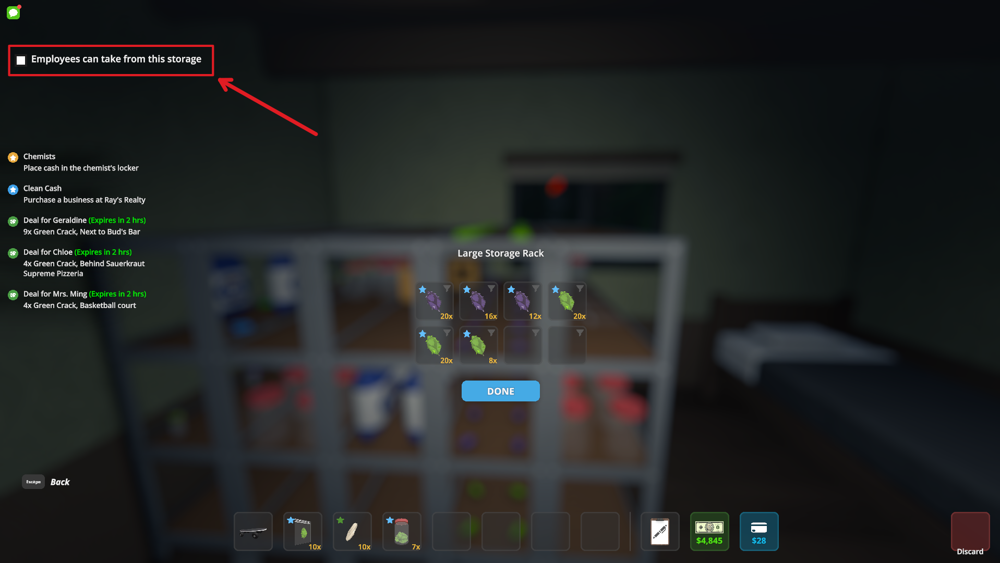
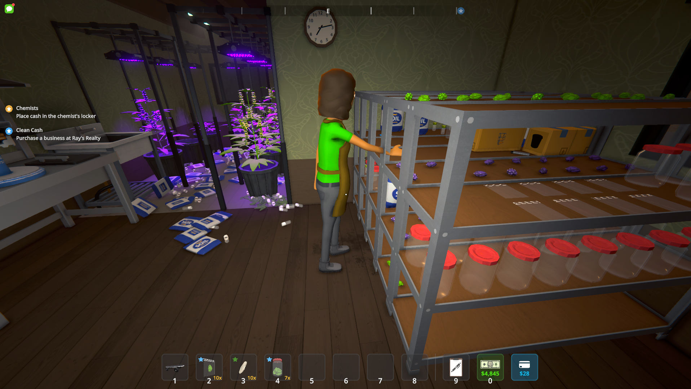
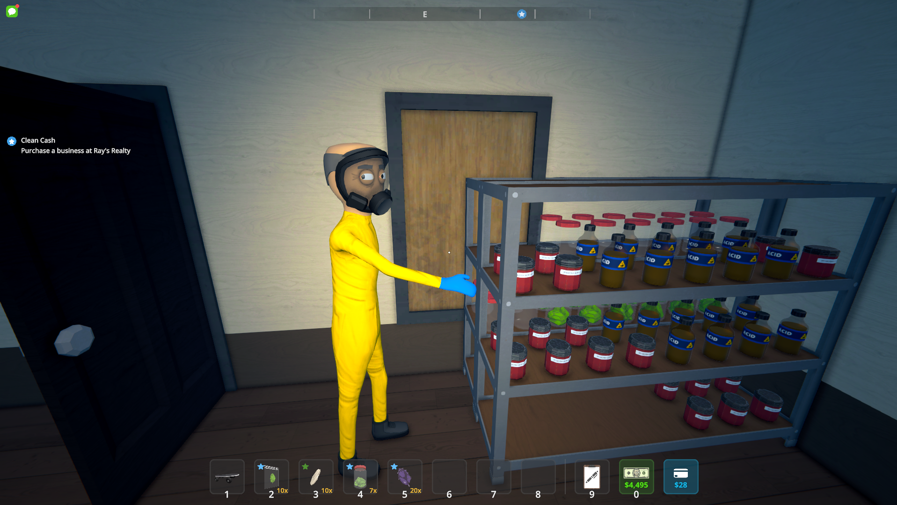
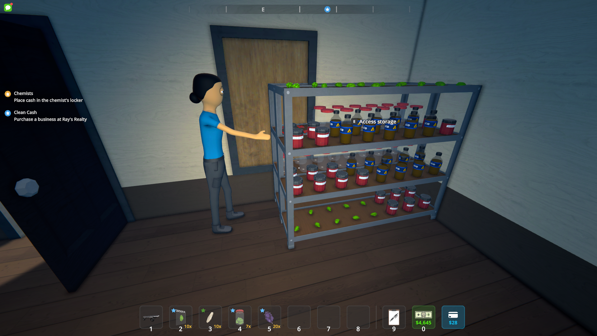
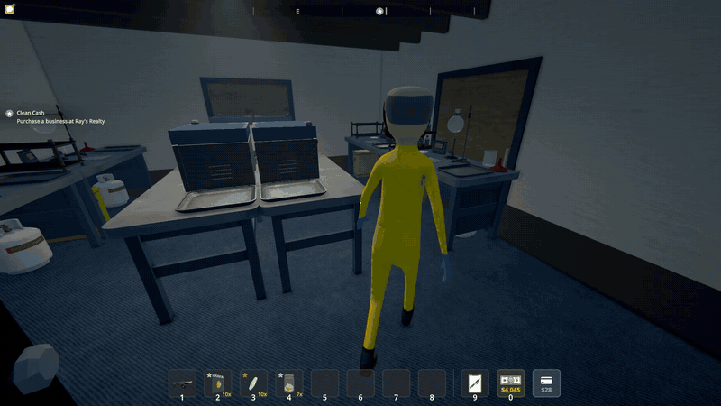

# The Employees Know

**Your workforce finally knows where everything is.**

In the vanilla game, employees have no way of retrieving the supplies they need directly from your property's storage. This forces players to rely on Handlers to manually deliver ingredients and materials to every machine so that Chemists, Botanists, and other workers can do their jobs.

This mod fixes that.

Employees can now locate and retrieve the items they need from any enabled storage on your property, as long as the required items are available. No more manually hauling ingredients from storage to every workstation. Your employees can find their own supplies and get straight to work!

This is a host-side, configurable, IL2CPP mod for Schedule I.

## Media

## Features

- **Property-wide storage access:** Employees can retrieve the supplies they need from any enabled storage on your property.
- **Botanists:** Can retrieve soil, seeds, additives, and spawn from any available storage on your property to supply their pots, drying racks, and other equipment.
- **Chemists:** Can retrieve ingredients from storage for use in chemistry stations, mixers, cauldrons, and lab ovens.
- **Handlers:** Can retrieve materials needed for packaging stations and brick presses like jars and baggies.
- **Delivery van storage:** Employees can access a delivery van's storage while it's parked on your property, retrieving the items they need to continue their work.
- **Individual storage permissions:** Enable or disable employee access to each storage container independently, giving you full control over which storages they can use.
- **No arbitrary carry limits:** Employees can transport as many items as their actual inventory slots and stack capacities allow, instead of being restricted by the vanilla 10-item limit.
- **Fully configurable:** All major features and behaviors can be independently disabled or adjusted.

## Requirements

- **Schedule I** — tested on `0.4.7f12`.
- **MelonLoader 0.7.3** or newer.
- **IL2CPP branch** of the game.

This build is **IL2CPP only**. It is not a Mono/Alternate build.

No S1API dependency is required.

## Installation

### Thunderstore

Install through the Thunderstore Mod Manager or import the release ZIP into your profile. MelonLoader is declared as a dependency.

### Manual

1. Install MelonLoader for Schedule I.
2. Extract `SmartStorage.dll` from the release ZIP and place it in your Schedule I `Mods` folder.
3. Launch the game.

The mod creates its configuration under `UserData` and stores per-save storage permissions in `UserData/SmartStorage`.

## How it works

The mod checks the storage entities enabled for employees and routes the required item to the assigned worker or station. It does not add a new storage UI or replace the game's storage system.

The per-storage checkbox is available in the storage menu. Disable a storage if you do not want employees to take from it.

## Configuration

The configuration is created in `MelonPreferences.cfg` under the existing `[SmartStorage]` section. The visible mod name is **The Employees Know**; the internal section is kept for compatibility with existing settings and permissions.

| Setting | Default | Description |
|---|---|---|
| `Enabled` | `true` | Turns the mod on or off. |
| `DefaultStorageAccess` | `true` | New storages start enabled for employees. |
| `EnableBotanist` | `true` | Botanists can use enabled storages. |
| `EnableChemist` | `true` | Chemists can fetch for their assigned stations. |
| `RecipeAwareChemistry` | `true` | Chemists only fetch recipe ingredients. |
| `AutoFilterChemistrySlots` | `true` | Apply recipe filters to chemistry ingredient slots. |
| `ChemistryRequirePositiveFilter` | `true` | Only fill ingredient slots with a positive whitelist. |
| `ChemistryFilterRefreshSeconds` | `1.0` | How often chemistry recipes are rescanned. |
| `EnablePackager` | `true` | Handlers can fetch for their assigned stations. |
| `PackagingProductAutoFillMode` | `FilteredOnly` | Off, FilteredOnly or Any. |
| `BrickPressProductAutoFillMode` | `FilteredOnly` | Off, FilteredOnly or Any. |
| `PreferVanillaSupply` | `true` | Prefer the vanilla supply storage when it contains the item. |
| `ChainAwareMixers` | `true` | Only feed the first mixer in a chain from storage. |
| `AutoFillLabOvens` | `true` | Chemists fill assigned lab ovens. |
| `LabOvenCookableOnly` | `true` | Lab ovens only receive cookable items. |
| `AllowDeliveryVehicleAccess` | `true` | Employees may use parked delivery vans. |
| `PreferDeliveryVehicles` | `true` | Prefer vans over normal storages for shared items. |
| `EnableChainMover` | `true` | Fallback output mover for mixer chains. |
| `ChainMoveDelaySeconds` | `3.0` | Delay before the fallback output mover acts. |
| `SearchIntervalSeconds` | `0.75` | How often idle employees search for a new source. |
| `Language` | `auto` | `auto`, `en`, `es`, `fr`, `de`, `pt`, `ru`, `zh` or `ja`. |
| `DebugLogging` | `false` | Extra diagnostic logging. |

## Known limitations

- **Host-only:** the mod applies its logic on the host.
- **IL2CPP only:** the current build is not compatible with the Mono/Alternate branch.
- **Game updates:** future Schedule I updates may change the Il2Cpp APIs used by the mod.

## Compatibility

The mod is designed to run alongside other mods and has been tested with Actually Working Employees and S1API in the author's setup. It does not require either of them.

## AI disclosure

This mod's code was developed with substantial AI assistance using **opencode** and **DeepSeek**. The author designed, integrated, verified and tested the features in-game. Promotional artwork and the icon were also generated as SVG artwork with AI assistance; gameplay screenshots are captured from the game.

## Support

If you want to support development: [Ko-fi — Employee of the Month](https://ko-fi.com/employeeofthemonth)

## License

**PolyForm Noncommercial License 1.0.0.** You may use, modify and share the mod for noncommercial purposes. Commercial use by anyone other than the licensor is not permitted.

See [LICENSE](https://github.com/wolfred24/The-Employees-Know/blob/main/LICENSE) for the full text.

Commercial use by anyone other than the copyright holder requires a separate written license. Contact the author through GitHub.

Copyright © 2026 Cesar Alfredo Martinez Gallegos.

## Credits

- Author: Cesar Martinez / [wolfred24](https://github.com/wolfred24)
- Team: [EmployeeOfTheMonth](https://thunderstore.io/teams/EmployeeOfTheMonth)
- Game: Schedule I by TVGS
